# Bao Chinese 包

**Chinese, one bite at a time.** A friendly, offline-first Mandarin starter course for Android — tone-first, character-first, and built for five-minute sessions.

[](https://github.com/LordGrimTaken/bao-chinese/actions/workflows/ci.yml)
[](https://github.com/LordGrimTaken/bao-chinese/actions/workflows/android.yml)

**[Open the app](https://lordgrimtaken.github.io/bao-chinese/)** · **[Download the Android APK](https://github.com/LordGrimTaken/bao-chinese/releases/latest)** · **[Read the research](docs/research.md)** · **[Product spec](docs/product.md)** · **[Curriculum](docs/curriculum.md)**

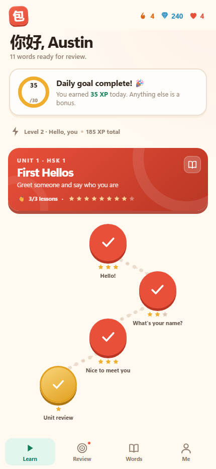

## What it is

Bao is a Duolingo-shaped Mandarin course that refuses to skip the parts generic apps skip:

- **Tones are explicit.** Every word has audio, pinyin, and a tone contour; tone questions are audio-first.
- **Minimal pairs, not guesswork.** The tone gym drills sets like mā/má/mǎ/mà and shū/shú/shǔ/shù with the character hidden until you answer.
- **You produce characters.** Trace the character you just learned; recognition is not treated as mastery.
- **Grammar gets one minute.** Every lesson has a plain-English “why” card.
- **Five minutes is enough.** 14–22 interactions, with a real completion screen.
- **It works offline.** No account, no server, no ads, no tracking. Your progress is local and exportable.
- **Bundled Mandarin audio.** 539 neural-voice clips cover every word, sentence, and tone pair; device TTS is the fallback.
- **It updates itself.** The Android build checks GitHub Releases, verifies the APK checksum, and hands it to Android's installer.
- **Gentle gamification.** Streaks, XP, gems, and hearts — with an unlimited-hearts setting and free review.

It is a **starter course for HSK 3.0 Level 1**: 11 units, 33 lessons, **217 lesson words**, 189 sentences, 33 grammar cards — plus the **complete 302-word HSK 1 vocabulary deck** in the dictionary (314 entries including 12 extra high-utility words). The word list is complete; sentence lessons for the remaining 97 deck-only words are the next content milestone. It is not exam prep.

## Screens

| Learn | Lesson | Review |
| --- | --- | --- |
|  | 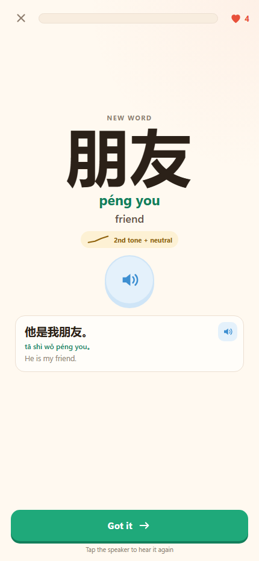 | 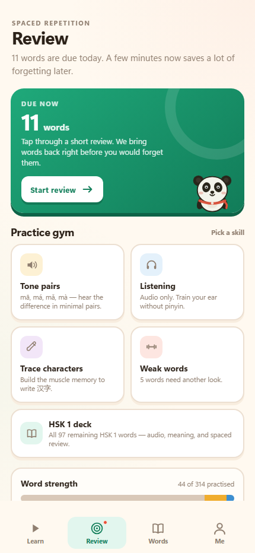 |

| Tone pairs | Update |
| --- | --- |
| 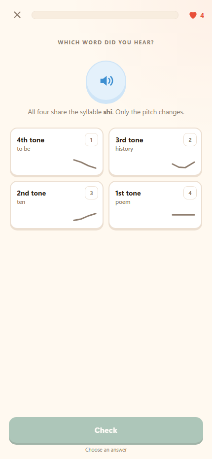 | 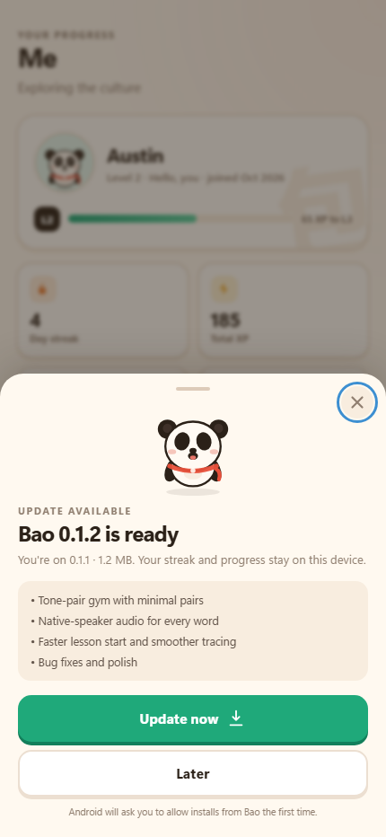 |

| Words | Profile | Completion |
| --- | --- | --- |
| 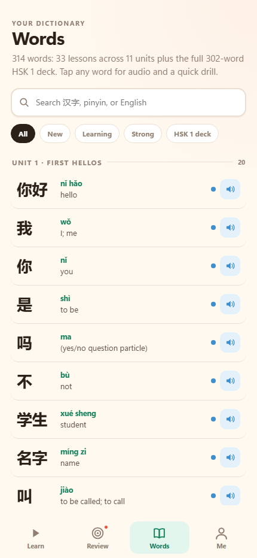 | 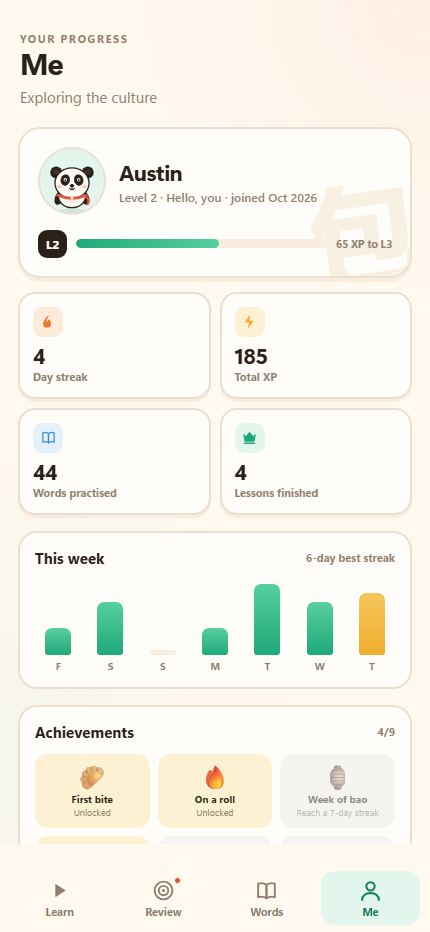 | 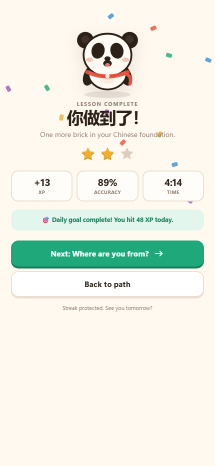 |

| Unit 9: Home & Tech | Unit 10: School & Work |
| --- | --- |
| 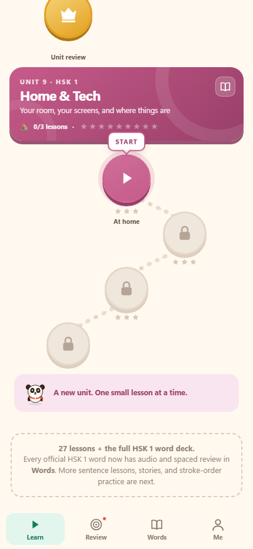 | 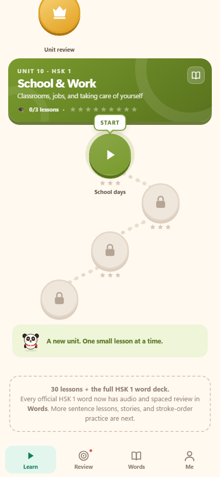 |

| Unit 11: Time & Dates | New lesson |
| --- | --- |
| 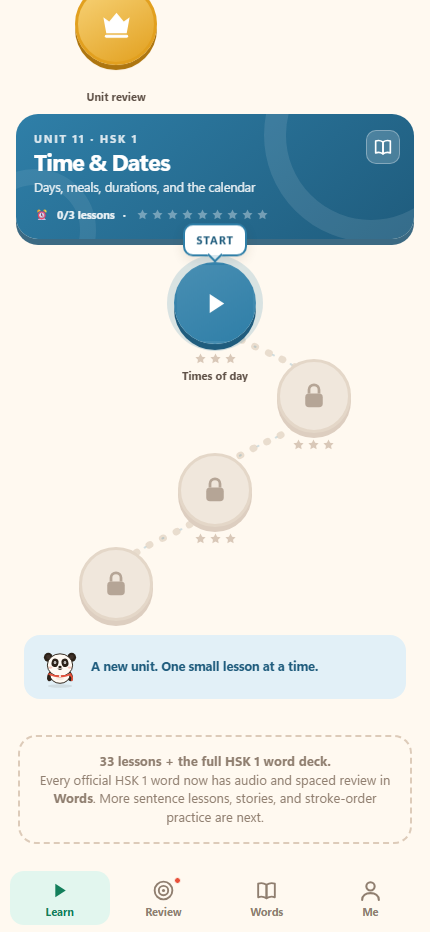 | 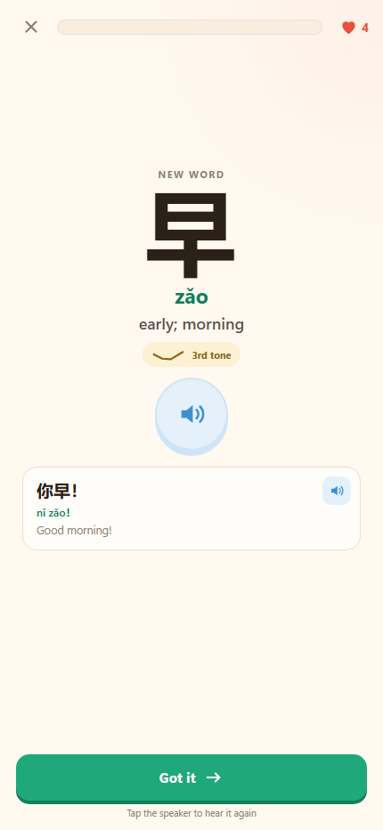 |

| Unit 9 lesson | Unit 10 lesson |
| --- | --- |
| 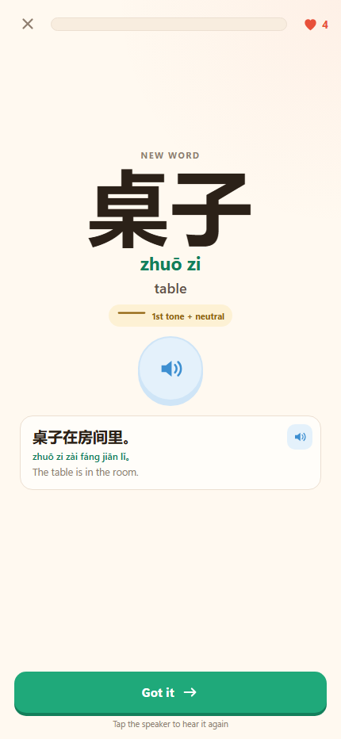 | 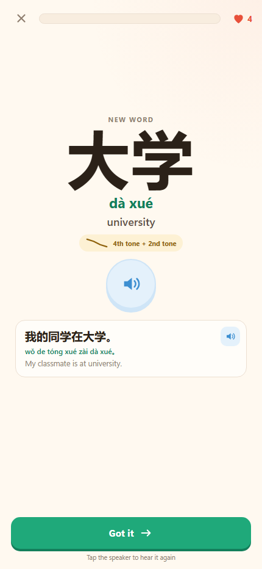 |

## Try it locally

Requires Node 20+ (no npm dependencies).

```bash
cd bao-chinese
node tools/serve.mjs
# http://127.0.0.1:5173
```

Demo routes for screenshots and QA:

```
/?demo=onboarding
/?demo=home
/?demo=review
/?demo=words
/?demo=profile
/?demo=lesson&lesson=u2l2
/?demo=lesson&lesson=u1l1&type=build
/?demo=tone-pairs
/?demo=complete
```

## Test

```bash
node tests/core.test.mjs        # 15 state, SRS, streak, hearts, gamification tests
node tests/lesson.test.mjs      # 12 content + exercise-generator tests
node tools/validate-content.mjs # token/pinyin/lesson/full-deck integrity
```

The full lesson can be played headlessly against a running Chrome/Edge with the DevTools protocol:

```bash
node tools/e2e-lesson.mjs u1l1
```

## Android

There are two Android paths:

1. **Install the PWA** from the GitHub Pages URL in Chrome → “Add to Home screen”. It is offline-capable and uses Web Speech for audio.
2. **Install the APK** — [download the latest build](https://github.com/LordGrimTaken/bao-chinese/releases/latest) (Android 8.0+, ~6 MB with all 478 audio clips). It is a thin WebView shell with native Android TTS and haptics. The `Android APK` workflow rebuilds it on every push to `main`.

The current APK is **demo-signed** for testing. Enable “Install unknown apps” for your browser/file manager, then open the downloaded `app-debug.apk`.

### Auto-update

The Android app checks `api.github.com/repos/LordGrimTaken/bao-chinese/releases/latest` on launch (throttled to once every 6 hours) and from **Me → Check for updates**.

When a newer release exists, it:

1. Downloads the APK to app-private storage.
2. Verifies the GitHub SHA-256 digest, package name, and version code.
3. Opens Android's `PackageInstaller` confirmation.

The first update needs “Allow from this source” for Bao. Progress stays on the device; the app does not use an account.

**One-time note:** v0.1.0 was signed with a throwaway CI debug key and has no updater code, so it cannot update itself. Reinstall v0.4.0 once. The v0.1.1+ builds are signed with the stable demo key and can update in place. The demo key is intentionally public for this prototype — see [android/keystore/README.md](android/keystore/README.md) before a Play Store release.

```bash
# requires JDK 17, Android SDK 35, and Gradle 8.9+
gradle -p android :app:assembleDebug
# android/app/build/outputs/apk/debug/app-debug.apk
```

The Android build copies the web app from the repo root at build time — there is no duplicated `www/` source. See [android/README.md](android/README.md).

## How it is built

- **No build step.** Vanilla ES modules, CSS, and JSON-free typed JS content. The service worker caches the shell.
- **Pure core.** `src/js/core.js` owns state, SRS, streaks, hearts, XP, and achievements; it is tested in Node.
- **Deterministic lessons.** `src/js/lesson-engine.js` turns a lesson into exercises with a seeded PRNG.
- **Single content source.** 314 typed dictionary entries and 128 tokenized sentences; pinyin is stored in numbered form and rendered with tone marks.
- **Thin native shell.** Android `WebView` + asset interception at a secure fake origin, with a `BaoNative` TTS/vibration bridge.

Read [docs/architecture.md](docs/architecture.md) for the full design.

## Coverage

| Unit | Theme | Lessons | Words |
| --- | --- | ---: | ---: |
| 1 | First Hellos | 3 | 20 |
| 2 | People & Family | 3 | 19 |
| 3 | Numbers & Time | 3 | 21 |
| 4 | Food & Drink | 3 | 19 |
| 5 | Getting Around | 3 | 18 |
| 6 | Daily Life | 3 | 18 |
| 7 | Describe It | 3 | 18 |
| 8 | Connect & Chat | 3 | 18 |
| 9 | Home & Tech | 3 | 20 |
| 10 | School & Work | 3 | 22 |
| 11 | Time & Dates | 3 | 24 |
| **Lesson total** | | **33** | **217** |
| **HSK 1 deck** | Remaining HSK 1 vocabulary (302 total, 97 still deck-only) | — | **97 deck-only** |
| **Dictionary total** | Course + HSK 1 deck + 12 extras | **33** | **314** |

What a learner can do after v0.1: greet, introduce themselves, talk about family, count, tell time, order basic food, talk about places/transport, describe simple things, and connect ideas. The HSK 1 deck adds audio, meaning, and spaced review for every remaining official HSK 1 word.

## Research & decisions

The short version:

- Duolingo is excellent at habit and recognition, but its Chinese course is weak on tones, handwriting, grammar, and natural listening. ([review](https://www.coco-chinese.com/blog/duolingo-chinese-review))
- The new HSK 3.0 Level 1 has **302 words** (not 150), so “HSK 1” is a bigger promise than it used to be. ([HSK 3.0 guide](https://graphchinese.com/hsk-3-0))
- A starter app should win on **tone training + character production + grammar clarity + offline simplicity**, not on catalog size.
- SM-2 is the right scheduler for a cold start; FSRS comes later. ([Anki docs](https://docs.ankiweb.net/faqs/what-spaced-repetition-algorithm))

Full sources and reasoning: [docs/research.md](docs/research.md).

## Roadmap

- **v0.2:** bundled neural audio, tone-pair gym, full HSK 1 word deck, auto-updater. *(shipped)*
- **v1.0:** sentence lessons for the remaining 97 deck words, 70 grammar points, stroke-order handwriting, traditional toggle, beta on Google Play.
- **Later:** HSK 2, graded readers, FSRS, accounts/sync, AI conversation with honest tone feedback.

See [docs/product.md](docs/product.md) for the full roadmap and metrics.

## License

MIT. Content (words, sentences, grammar explanations) is original to this project. Emoji are rendered by the platform. See [LICENSE](LICENSE).
